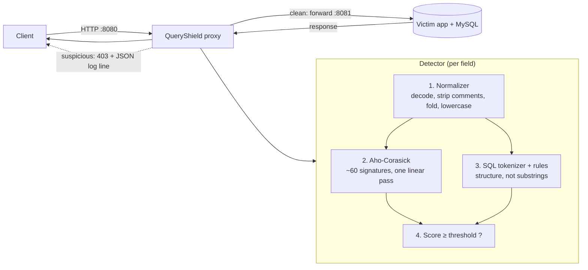

# QueryShield

**A Java reverse proxy that screens HTTP requests for SQL injection.**

> Status: **Working.** Builds and runs from a clean clone; every number below is
> produced by a script in this repo and is reproducible (see [Results](#results)).

QueryShield sits in front of a database-backed web app, inspects each request,
and blocks the ones that look like SQL injection with a `403` before they reach
the app — forwarding clean traffic unchanged. It is **defence in depth**, not a
replacement for parameterized queries (see [Limitations](#limitations--future-work)).

The interesting parts — the Aho-Corasick automaton, the request normalizer, the
SQL tokenizer, the rules and scoring, and the evaluation — are **written by
hand**, not pulled from a WAF library. The JDK's `com.sun.net.httpserver` and
`java.net.http` are used only as plumbing.

---

## How it works



Every inspectable value — the path, each query parameter, each form field, each
JSON string value, and the configured headers (`Cookie`, `User-Agent`,
`Referer`) — is scored **independently**, so a block can name the exact
parameter and unrelated fields can't sum into a phantom attack.

1. **Normalize** ([`normalize/`](src/main/java/com/queryshield/normalize)) —
   undo the tricks that hide a payload: percent-decode (bounded to 3 rounds),
   `+`→space, NFKC fold (fullwidth → ASCII), strip NUL, replace/unwrap comments,
   collapse whitespace, lowercase. Each character carries its **origin index**
   back to the raw request, so a match can point at the real bytes sent.
2. **Match signatures** ([`match/`](src/main/java/com/queryshield/match)) — an
   Aho-Corasick automaton finds every signature in **one linear pass**,
   independent of how many signatures there are.
3. **Tokenize + apply rules** ([`sql/`](src/main/java/com/queryshield/sql),
   [`rules/`](src/main/java/com/queryshield/rules)) — a hand-written,
   error-tolerant lexer turns the value into tokens; structural rules
   (UNION→SELECT, stacked `;`+DML, quote-then-comment, gated tautology, …) catch
   what substrings miss and ignore benign text that merely contains the words.
4. **Score** ([`detect/`](src/main/java/com/queryshield/detect)) — signature and
   rule weights sum; block when the score reaches the configured threshold.

---

## Build and run (from a clean clone)

**Prerequisites:** a JDK 21+ (the code targets `--release 21`), a running local
MySQL (8.4+/9.x), and `make`, `curl`, `jq`. No Homebrew, Maven, Gradle or Docker
required. `make deps` fetches exactly two jars (MySQL Connector/J and the JUnit
console launcher) from Maven Central and verifies each against a pinned SHA-256.

```bash
git clone https://github.com/Kunal0626/queryshield.git
cd queryshield
make deps          # fetch + checksum the two dependency jars
make build         # javac --release 21 -> out/
make test          # 562 tests (incl. a 500-run Aho-Corasick property test)
```

One-time database setup (creates the `queryshield` DB and a least-privilege
`qsdemo` user; **MySQL prompts you for the root password — the script never
sees it**, and writes a gitignored `victim/local.properties`):

```bash
bash victim/setup_db.sh
```

See the attacks against the unprotected app, then run the stack and prove the
proxy stops them:

```bash
bash victim/exploit_demo.sh      # 3 real injections succeed on the raw app
make victim                      # terminal 1: vulnerable app on :8081
make proxy                       # terminal 2: QueryShield on :8080
make e2e                         # asserts exploits are blocked through the proxy
make eval                        # detection numbers  -> eval/results/eval.md
make loadtest                    # throughput/latency -> eval/results/phase9-loadtest.md
```

---

## Usage examples (real captured output)

**The vulnerable app is genuinely exploitable** (from `bash victim/exploit_demo.sh`,
full log in [`docs/phase1-exploit-demo.txt`](docs/phase1-exploit-demo.txt)):

```
# POST /login  (username=[admin' -- ]  password=[anything])
{ "authenticated": true, "id": 1, "username": "admin", "is_admin": true }

# GET /search  (q = [' UNION SELECT id, value, 1 FROM secrets -- ])
{ "results": [ ... { "name": "FAKE{queryshield_union_based_extraction_demo}" } ] }

#   baseline  id=1              : 0.006138s
#   injected  id=1 AND SLEEP(2) : 2.013145s   <- time-based blind
```

**The proxy blocks the same attacks** and returns a request id, while clean
traffic is forwarded unchanged:

```
$ curl -s "http://127.0.0.1:8080/search?q=mug"
{"results":[{"id":3,"name":"Union Station Mug","price":12.00}]}      # 200, forwarded

$ curl -s --get "http://127.0.0.1:8080/search" \
       --data-urlencode "q=' UNION SELECT id, value, 1 FROM secrets -- "
{"error":"request blocked by QueryShield","request_id":"79d3b797","score":18}   # 403
```

**Every decision is one JSON log line** naming the parameter and what matched:

```json
{"ts":"...","rid":"f09cbb98","mode":"block","verdict":"block","method":"GET",
 "path":"/search","score":18,
 "matches":[{"loc":"query","param":"q","source":"signature","label":"union select","weight":5,"raw_at":4},
            {"loc":"query","param":"q","source":"rule:union-select","label":"union-select","weight":5,"raw_at":4}]}
```

---

## Results

All numbers below were produced on this machine and are regenerated by the
commands shown. They are **not** hand-written into this file.

**Environment:** macOS (Darwin 25.6.0, arm64) · OpenJDK 25.0.1 (compiled
`--release 21`) · MySQL 9.5.0. Dataset: 103 attack + 102 benign payloads, split
50/50 dev/test, stratified by category (see [`data/README.md`](data/README.md)).

### Detection — `make eval` ([eval/results/eval.md](eval/results/eval.md))

Rules were tuned on the **dev** split; these are the untouched **test** split:

| Configuration | Recall (detection) | False-positive rate | Precision |
|---|---:|---:|---:|
| v1 — signatures only | 89.6% | 6.4% | 93.5% |
| v2 — + normalizer | 97.9% | 6.4% | 94.0% |
| **v3 — + tokenizer rules & scoring** | **100.0%** | **2.1%** | **98.0%** |

The normalizer (v1→v2) adds **+8.3 points of recall** by defeating
encoded/comment obfuscation. Rules + scoring (v2→v3) cut the false-positive rate
from 6.4% to 2.1% and lift precision to 98% while reaching full recall on this
set. The one remaining false positive is the benign search phrase
`union select explained`, kept and discussed rather than hacked away.

### Overhead — `make loadtest` ([eval/results/phase9-loadtest.md](eval/results/phase9-loadtest.md))

16 threads, 10 s measured after warm-up, one captured run:

| Request | Direct to app | Through proxy |
|---|---|---|
| `/search` (DB-backed) | 295 req/s, p50 50.6 ms | 344 req/s, p50 44.8 ms |
| `/` (no DB — isolates proxy cost) | 54,043 req/s, p50 0.28 ms | 24,119 req/s, p50 0.62 ms |

On DB-backed traffic the MySQL query (~50 ms) dominates, so the proxy's cost is
**within run-to-run variance** (the sign can flip between runs — not a
production benchmark). The no-DB row isolates the proxy's own cost: it adds
**~0.3 ms (p50) / ~0.7 ms (p99)** per request and still sustains ~24k req/s on a
single machine over loopback.

---

## Project layout

```
queryshield/
├── Makefile                 the whole build (javac + make)
├── config/                  proxy config (thresholds, headers, allow-list)
├── data/                    labelled dataset + the seeded builder
├── docs/                    INTERVIEW_NOTES, resume bullets, captured runs
├── eval/results/            committed measured output (eval.md, load, e2e)
├── src/main/java/com/queryshield/
│   ├── normalize/  match/  sql/  rules/  detect/   the detector, by hand
│   ├── proxy/                                       the reverse proxy
│   ├── victim/                                      VULNERABLE demo app
│   └── eval/                                        harness + load generator
├── victim/                  SQL schema/seed, setup_db.sh, exploit_demo.sh
├── e2e_test.sh  loadtest.sh end-to-end + load orchestration
└── src/test/java/...        562 tests
```

---

## Limitations / future work

QueryShield is a signature/tokenizer layer and **can be bypassed**. It is not a
substitute for parameterized queries (the `/safe/*` endpoints show the real
fix). Known gaps, stated honestly:

- **Second-order injection** — a payload stored now and used in a query later —
  is not addressed; the proxy only sees the request in front of it.
- **Payload split across fields** — each field is scored independently, so an
  attack divided across two parameters evades the per-field score.
- **Encodings the normalizer doesn't model** — percent-decoding is capped at 3
  rounds (4×-encoding gets through); only ASCII whitespace is collapsed; NFKC is
  per-code-point. Each is a deliberate, documented trade-off against
  normalizing *differently from the backend* (a "parser differential").
- **One benign false positive** (`union select explained`) remains on the test
  set — an irreducible collision between a strong attack signal and a rare
  benign phrase.
- **The response is buffered, not streamed** — fine for this app, a limitation
  for large or streaming responses.
- **Not run against `sqlmap`** yet (stretch goal). Any such claim is marked
  `needs:` in [`docs/RESUME_BULLETS.md`](docs/RESUME_BULLETS.md).

See [`docs/INTERVIEW_NOTES.md`](docs/INTERVIEW_NOTES.md) for the design decisions
and the hardest questions this project should be able to answer.

---

Part of my portfolio: [github.com/Kunal0626](https://github.com/Kunal0626)
